# Voz Porteña

[](https://github.com/JuanTrezza/encuesta-caba-pwa/actions/workflows/ci.yml)

PWA para puntuar y comentar cómo funciona la vida cotidiana en los 48 barrios de Buenos Aires: limpieza, transporte, espacios verdes, eventos gratuitos, subte, seguridad y accesibilidad. Funciona sin conexión, tiene un mapa por barrio y una página de resultados.

Proyecto independiente, sin relación con el Gobierno de la Ciudad de Buenos Aires.

**Demo:** https://juantrezza.github.io/encuesta-caba-pwa/

## Capturas

Las capturas usan datos de ejemplo.

| Inicio | Categoría | Mapa | Resultados | Sin conexión |
|---|---|---|---|---|
| 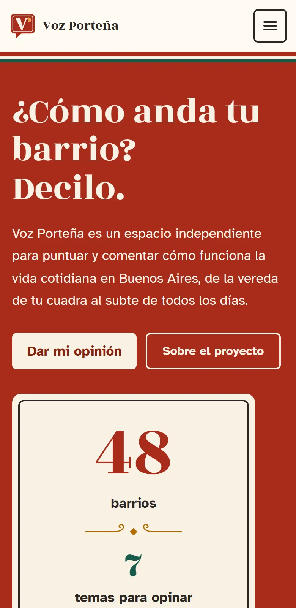 | 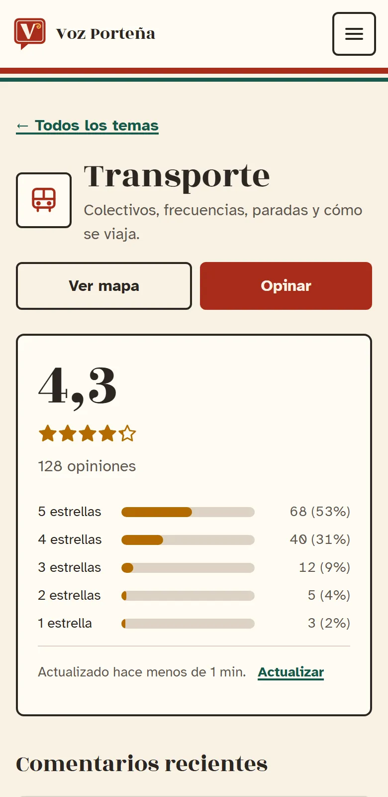 | 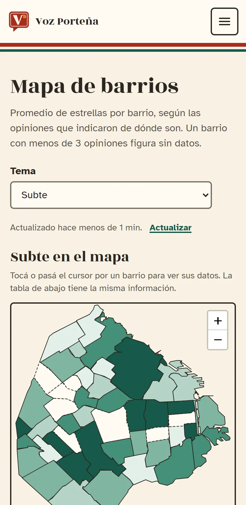 | 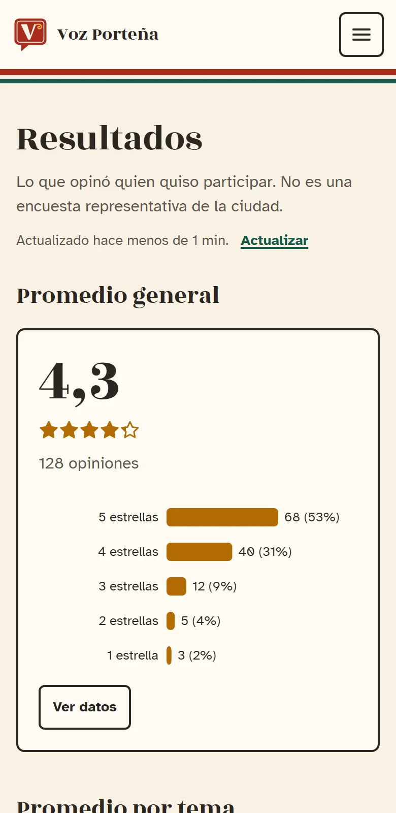 | 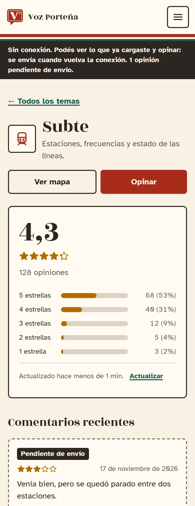 |

<details>
<summary>Ver en escritorio</summary>

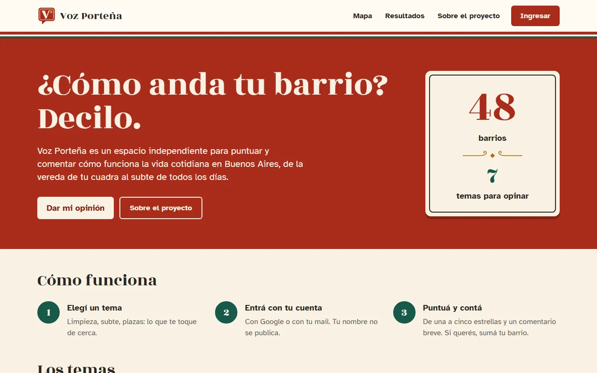
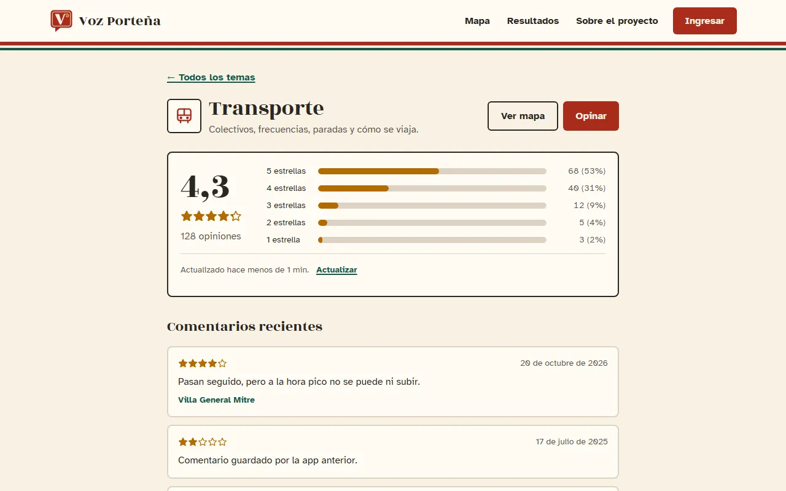
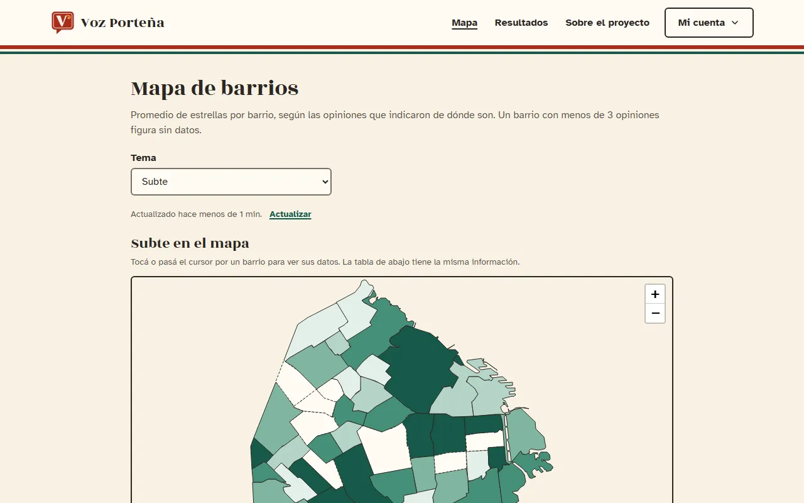
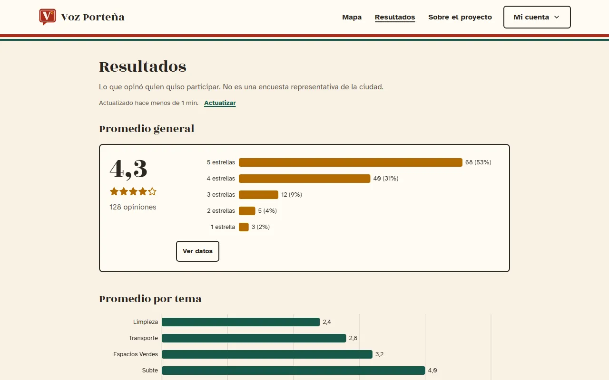
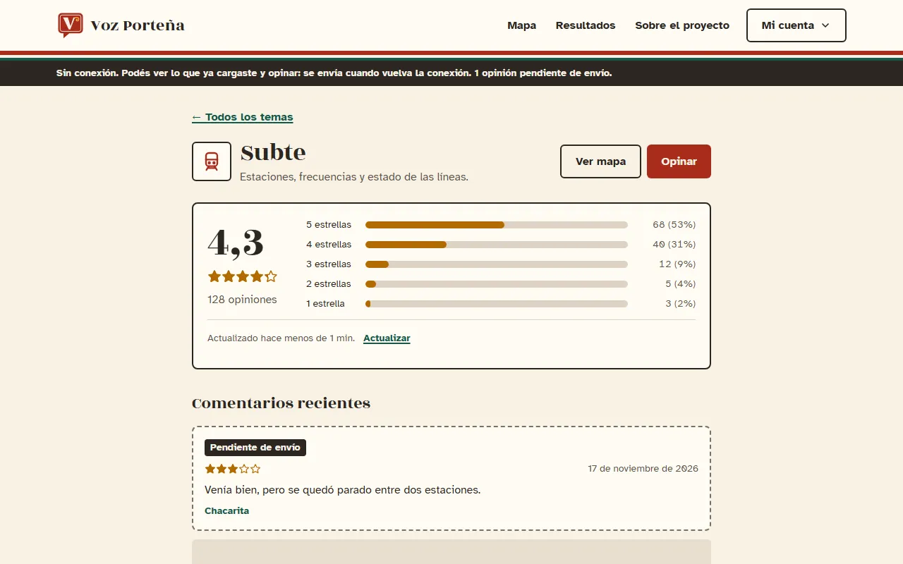

</details>

## Qué hace

- **Opinar:** de 1 a 5 estrellas, un comentario y, si querés, el barrio. Se entra con Google o con mail.
- **Leer:** cada tema muestra su promedio, la distribución de estrellas y los comentarios recientes. No hace falta cuenta.
- **Borrar lo propio:** cada persona puede borrar sus opiniones, con confirmación, desde "Mis opiniones" o en el tema. No se pueden editar.
- **Mapa:** un coroplético de los 48 barrios, con una tabla que tiene los mismos datos.
- **Resultados:** promedio general y por tema, evolución mensual y los barrios mejor y peor puntuados.
- **Sin conexión:** el sitio abre, muestra lo que ya viste y deja opinar. La opinión queda en una cola y se envía sola al volver la conexión.
- **Accesibilidad:** se usa entero con teclado, tiene foco visible y los gráficos traen un resumen en texto y su tabla.

## Stack

| Capa | Tecnología |
|---|---|
| Interfaz | React 19, TypeScript strict, Tailwind CSS v3, React Router (`HashRouter`) |
| Build | Vite 6 |
| Datos | Firebase JS SDK v11: Auth y Firestore, con reglas de seguridad |
| PWA | vite-plugin-pwa con Workbox y un service worker propio |
| Offline | Caché persistente de Firestore más IndexedDB (`idb`) para la cola y los agregados |
| Mapa | Leaflet y react-leaflet, sin mapa base |
| Gráficos | SVG propio, sin librerías |
| Tests | Playwright (e2e y accesibilidad con axe) y el emulador de Firestore para las reglas |
| Deploy | GitHub Actions y GitHub Pages |

## Arquitectura

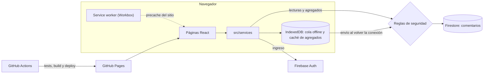

No hay backend propio. El navegador habla directo con Firebase, y lo que se puede leer o escribir lo deciden las reglas de Firestore.

## Decisiones técnicas

### La apiKey web no es secreta

La `apiKey` de la config web de Firebase identifica al proyecto, pero no da acceso a los datos. Tiene que llegar al navegador para que la app funcione, así que cualquiera puede leerla en el JavaScript publicado. Guardarla en `.env.local` y en los secrets de GitHub evita tenerla en el repo, pero no la oculta.

No pasa lo mismo con las credenciales de servidor, como una service account, su `private_key`, un token de la CLI de Firebase o la server key de FCM. Esas dan acceso real: nunca van en este repo ni en una variable `VITE_*`, porque todo lo que empieza con `VITE_` termina en el bundle público.

Lo que protege los datos:

| Capa | Qué hace |
|---|---|
| Reglas de Firestore | Deciden quién puede leer o escribir y validan cada documento. Son la protección principal. |
| Restricción por dominio | Limita desde qué sitios se acepta la key. Se basa en el encabezado `Referer`, que fuera del navegador se puede falsificar. |
| Restricción por API | Limita qué APIs de Google se pueden llamar con la key. |
| Dominios autorizados | Limita en qué dominios funciona el login. |
| App Check | Ayuda a comprobar que los pedidos vienen de esta app. Está preparado, pero no activado. |

El build falla si alguna variable `VITE_FIREBASE_*` falta o tiene un formato inválido, y el mensaje nunca muestra los valores.

### Reglas validadas con tests

[firestore.rules](firestore.rules) permite leer a cualquiera y crear solo a quien ingresó. Cada opinión tiene que llevar el `uid` de quien la escribe, la fecha del servidor, una puntuación entera de 1 a 5, un tema y un barrio de las listas válidas, y un texto de 1 a 500 caracteres. No admite campos extra. Nadie puede editar. Borrar solo puede quien la escribió, comparando el `uid` del documento con el de la sesión; las opiniones viejas, que no tienen `uid`, no las puede borrar nadie desde la app.

`npm run test:rules` prueba cada una de esas condiciones en el emulador de Firestore. También comprueba que las listas de temas y barrios de las reglas coincidan con las del código.

Cada opinión guarda el `uid`, no el nombre ni el mail. Es lo que permite que cada persona borre lo suyo y arme su lista de "Mis opiniones". Como la lectura es pública, ese `uid` también lo es.

### Agregados sin backend

El mapa y la página de resultados usan `count()` y `average()` de Firestore, que calculan en el servidor sin descargar los documentos.

| Vista | Consultas agregadas |
|---|---|
| Resultados | Entre 73 y 85 |
| Mapa | 48 por tema |
| Categoría | 5 |

Para no repetirlas, el último resultado se guarda en memoria y en IndexedDB y vale 30 minutos. La página muestra "Actualizado hace X min" y un botón para volver a pedirlo. Publicar una opinión propia también lo renueva.

### Offline con cola

- El service worker ([src/sw.ts](src/sw.ts)) guarda todo el sitio en el dispositivo, incluidos el mapa y las tipografías.
- Los comentarios ya vistos salen de la caché persistente de Firestore. Los agregados, de la caché propia.
- Una opinión escrita sin conexión queda en una cola en IndexedDB y figura como "Pendiente de envío". Se manda sola al volver la conexión, con la fecha que pone el servidor en ese momento.
- Una versión nueva del sitio se activa recién cuando la persona toca "Actualizar".

### Mapa sin teselas

El mapa dibuja solo los polígonos de los barrios, sin un mapa base de terceros. Así funciona sin conexión, no envía datos de navegación a otro servidor y no depende de las condiciones de uso de un proveedor de teselas. La contra es que no muestra calles.

El color sigue una escala de un solo tono, de claro a oscuro, que se distingue por luminosidad y no depende de diferenciar colores. Un barrio con menos de 3 opiniones figura sin datos.

### Rendimiento

Firebase, Leaflet y cada página pesada se descargan recién cuando hacen falta. Lighthouse en modo mobile, mediana de 3 corridas sobre un build local:

| Página | Rendimiento | Accesibilidad | Buenas prácticas | SEO |
|---|---|---|---|---|
| Inicio | 94 | 100 | 100 | 100 |
| Mapa | 77 | 100 | 100 | 100 |
| Resultados | 94 | 100 | 100 | 100 |

Mapa y Resultados se midieron con datos de ejemplo y sin el SDK de Firebase, así que en producción el rendimiento es algo menor.

## Cómo correrlo

Hace falta Node 20 o superior y un proyecto de Firebase con Auth y Firestore.

```bash
npm ci
cp .env.example .env.local   # completá los valores de la config web de Firebase
npm run dev
```

La app corre en `http://localhost:5173/encuesta-caba-pwa/`. La configuración de Firebase y de GitHub está en [docs/firebase-setup.md](docs/firebase-setup.md).

| Comando | Qué hace |
|---|---|
| `npm run typecheck` | Corre `tsc` |
| `npm run build` | Corre `tsc`, valida `VITE_FIREBASE_*` y genera `dist/` |
| `npm run test:e2e` | Corre Playwright en 320, 375 y 1440 px |
| `npm run test:rules` | Prueba las reglas de Firestore en el emulador |

### Tests e2e

No tocan Firebase: con `--mode e2e`, Vite reemplaza `src/services/auth.ts`, `src/services/comentarios.ts` y `src/services/pwa.ts` por `tests/mocks/`. La cola offline, la caché y el service worker que se prueban son los reales. Si es la primera vez, instalá el navegador con `npx playwright install chromium`.

### Tests de reglas

Necesitan **Java 21 o superior**, porque el emulador de Firestore corre sobre Java.

```bash
winget install EclipseAdoptium.Temurin.21.JDK   # solo la primera vez; después abrí otra terminal
npm run test:rules
```

El comando levanta el emulador con el proyecto `demo-voz-portena`, corre los tests y lo apaga. Los proyectos `demo-` no existen en Firebase, así que no se toca ningún dato real. Los mensajes `PERMISSION_DENIED` del log son los rechazos que los tests esperan. El emulador no exige índices compuestos, así que estos tests no comprueban que estén creados.

## Estructura

- `src/services/`: capa de datos. Las páginas usan `opiniones.ts` y no importan Firebase.
- `src/pages/` y `src/components/`: interfaz.
- `src/data/`: temas, barrios y escala de colores del mapa.
- `src/sw.ts`: service worker.
- `tests/` y `tests-rules/`: tests e2e y de reglas.
- `firestore.rules` y `firestore.indexes.json`: reglas e índices.
- `legacy/`: sitio anterior. No se publica.

## Roadmap

- **Notificaciones push con FCM.** Hace falta la clave VAPID pública, pedir permiso y guardar el token, y alguien que envíe. La API de FCM exige una credencial de servidor: las Cloud Functions necesitan el plan Blaze, y la alternativa es una tarea programada con una service account guardada como secret.
- **App Check en modo Enforce.** El código ya lo inicia si existe `VITE_FIREBASE_APPCHECK_SITE_KEY`. Falta registrar la clave de reCAPTCHA v3, mirar las métricas y recién entonces exigirlo.
- **Documento de resumen.** Si crece el tráfico, conviene reemplazar las decenas de consultas agregadas por un documento que mantenga un proceso de servidor.
- **Moderación.** Cada persona borra lo suyo, pero las opiniones viejas (sin `uid`) y las que haya que sacar por abuso solo se pueden borrar a mano desde la consola de Firebase.

## Datos abiertos

Los límites de los barrios salen del conjunto de datos [Barrios](https://data.buenosaires.gob.ar/dataset/barrios) de Buenos Aires Data, publicado por la Secretaría de Innovación y Transformación Digital del Gobierno de la Ciudad con licencia [CC BY 2.5 AR](https://creativecommons.org/licenses/by/2.5/ar/).

El archivo `public/barrios.geojson` es una versión modificada: coordenadas redondeadas a 4 decimales y nombres adaptados a los de este sitio. Se regenera con `node scripts/preparar-barrios.mjs`. Usar esos datos no implica ningún aval ni relación con el Gobierno de la Ciudad.

## Autor

Juan Moreno Trezza · [GitHub](https://github.com/JuanTrezza)
